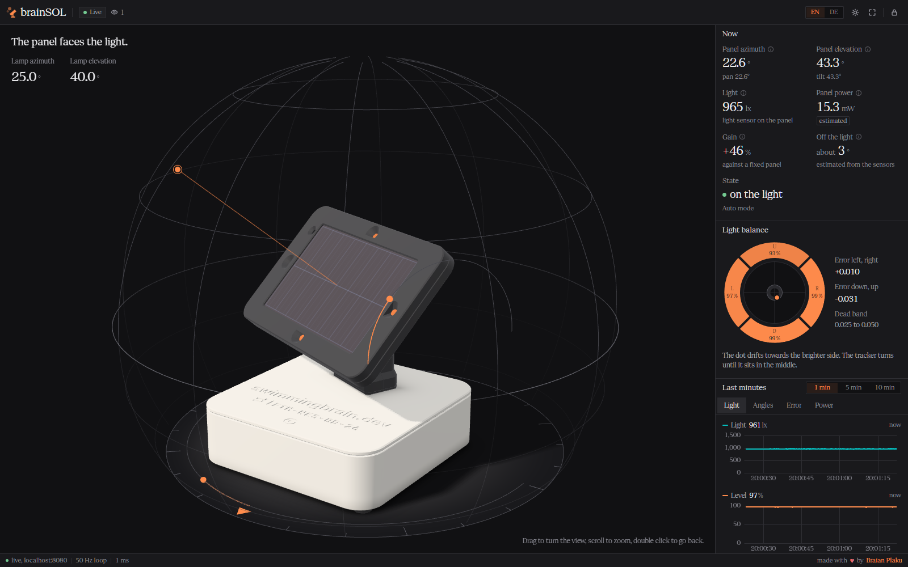
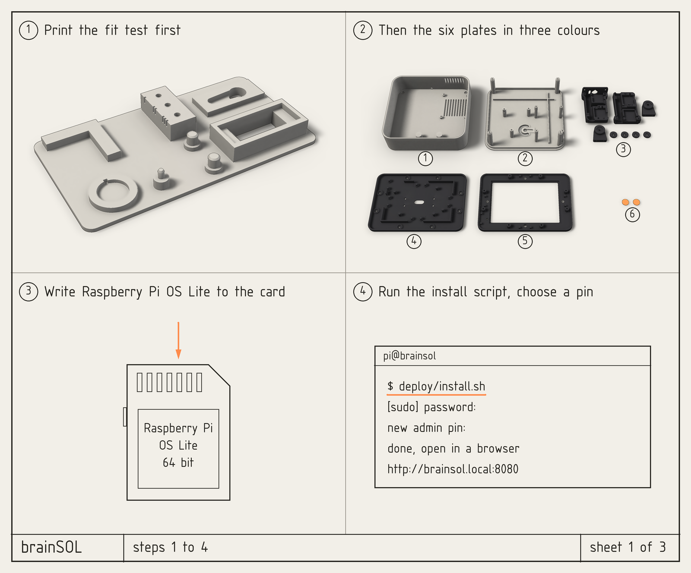
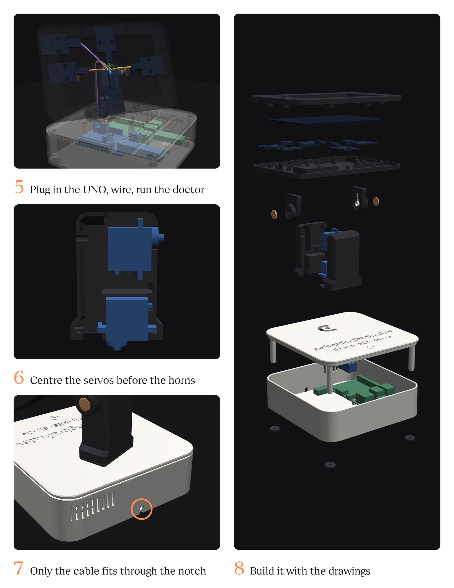
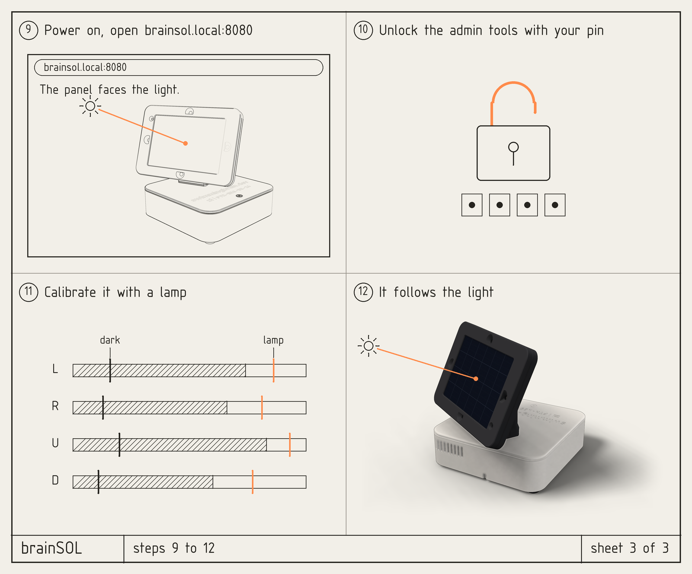
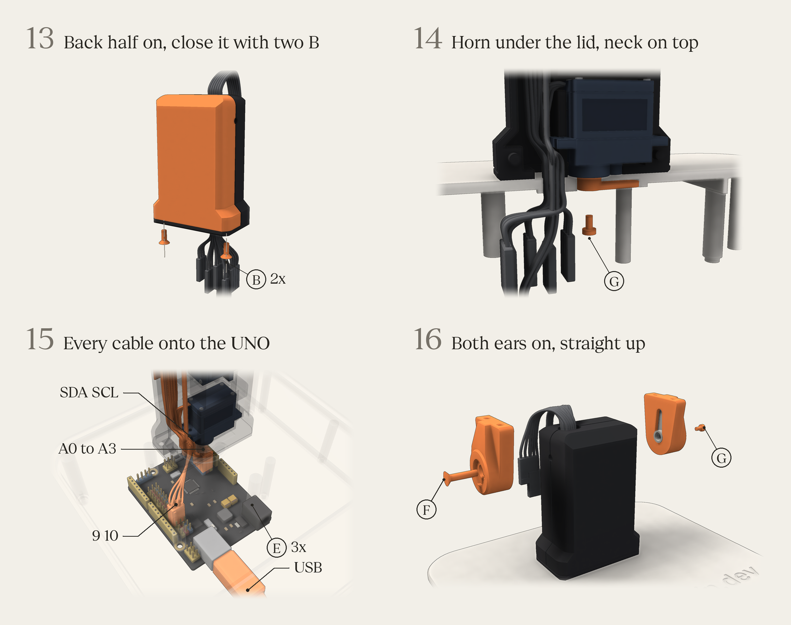
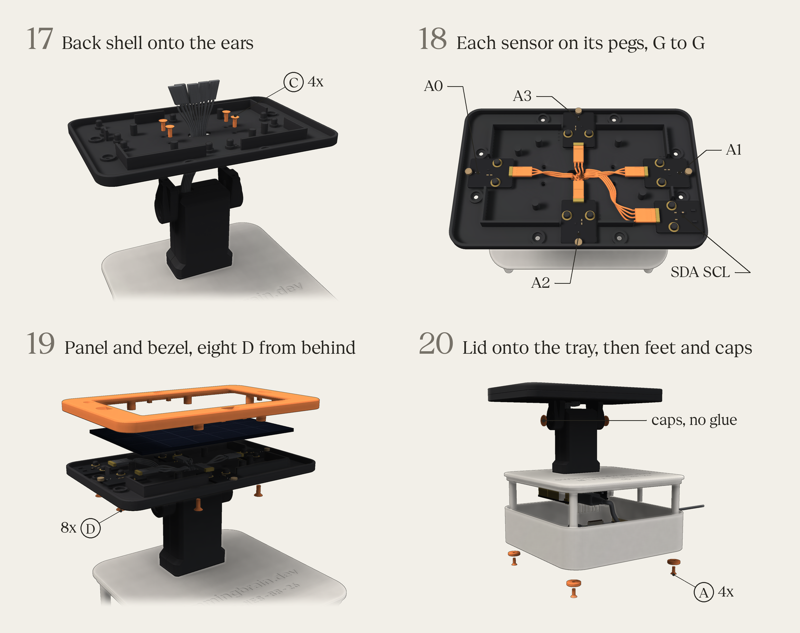
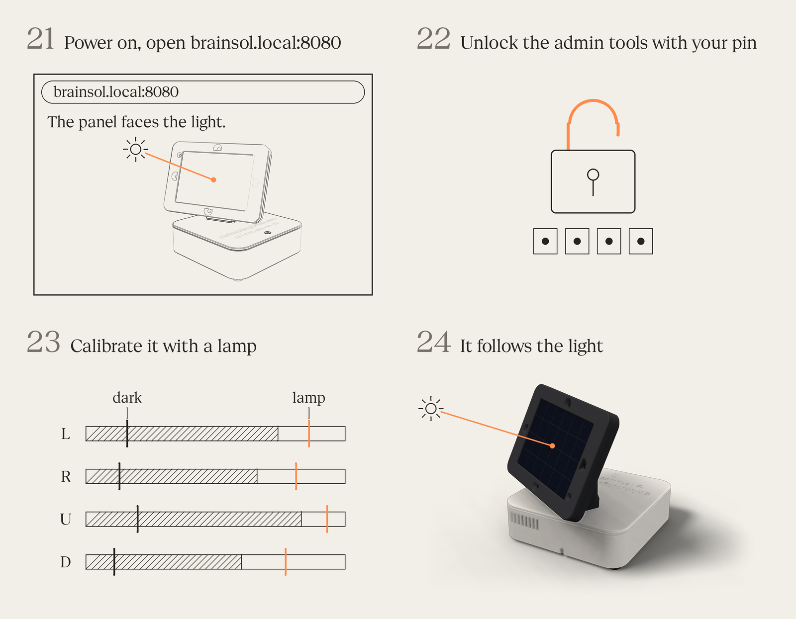

<h1 align="center">brainsolpi</h1>

<p align="center">
  The Raspberry Pi side of brainSOL, a dual axis solar tracker that turns its panel toward the light.<br/>
  Built from the Keyestudio KS0530 kit, a Raspberry Pi and a 3D printed body.
</p>

<p align="center">
  
</p>

<p align="center">
  <a href="https://sol.swimmingbrain.dev"><strong>See it live at sol.swimmingbrain.dev</strong></a>
</p>

## Try it without hardware

On any computer with [uv](https://docs.astral.sh/uv/):

```
git clone https://github.com/swimmingbrain/brainsolpi.git
cd brainsolpi
uv run brainsolpi demo
```

It simulates the whole tracker and prints the address to open and a pin for the admin tools. Ctrl+C ends it,
nothing is kept.



## What you need

- From the KS0530 kit: the UNO, both servos with their horns, the four light sensor modules, the BH1750, the
  solar panel, four 3 pin cables, the long 4 pin cable, the USB cable, the screws and the two screwdrivers
- A Raspberry Pi 3B+ with the official 5.1 V 2.5 A micro USB supply, or a Pi 4 with the official 5.1 V 3 A
  USB C supply. The Pi also powers the UNO and both servos, a phone charger is too weak
- A micro SD card with 16 GB or more
- Matte PLA, about 275 g light grey or white and 185 g charcoal, plus 2 g of copper PLA

Nothing else to buy.

## Print



Print `hardware/export/stl/fit_test.stl` and one `cap.stl` first, it takes half an hour. Check it with the kit
parts: a servo goes into its frame spline down and rests on its tabs, a horn sits tight in its pocket, a sensor
module slides over the pegs, the panel corner drops into its pocket and a kit screw holds firm in the hole with
two notches. Then print `hardware/export/stl/servo_test.stl`, about ten minutes, and try a servo in it before
you print the neck. If something is off, change its value in `hardware/cad/params.py` and run
`uv run build.py` in `hardware/`.

Then print the six plates in `hardware/export/3mf/`: body in light grey or white, dark in charcoal, accent in
copper. That takes about 11.5 hours. Start from the Bambu Studio profile for matte PLA with the 0.4 mm nozzle
and change only this: 4 walls, 5 top and 4 bottom layers, gyroid infill 15 % (25 % for the neck, 40 % for the
ears, 100 % for feet and caps), supports off, elephant foot compensation 0.15 mm. Every part fits the bed of a
Bambu Lab A1 mini. The ears stand on their end face as the plate file places them, they need no supports and a
brim is optional. The back shell and the bezel are 176 mm wide and fill the bed, do not rotate them and print
them without brim or skirt.

## Set up the Pi

Write the SD card with the Raspberry Pi Imager:

- Device: your Pi. System: Raspberry Pi OS (other), then Raspberry Pi OS Lite (64 bit)
- Host name: `brainsol`
- User name and password: your own
- WiFi: your network and country
- SSH: on, with password

Put the card into the Pi, plug in the power and wait a few minutes. Then in a terminal on your computer:

```
ssh <user>@brainsol.local
sudo apt update && sudo apt install -y git
git clone https://github.com/swimmingbrain/brainsolpi.git
cd brainsolpi
deploy/install.sh
```

Run the install right in this terminal, sudo asks for your password from the Imager. Then the install asks
for an admin pin, 4 to 32 characters, it unlocks the admin tools on the page. Log out and in again once, then
`brainsolpi` works as a command.

The page now answers at `http://brainsol.local:8080`. It shows the simulation until the kit is wired.

## Wire and assemble



Do the wiring on the table first. Plug the UNO into the lower USB port of the Pi, next to the Ethernet jack.
Within about 15 s the service sees that the UNO does not answer yet, writes the bridge firmware to it and
then uses the board. `journalctl -u brainsolpi -f` shows it. If it says it left the board alone or the flash
failed, run `brainsolpi flash`.

Plug in the sensors and servos as [docs/wiring.pdf](docs/wiring.pdf) shows: G to G on every sensor cable,
brown on G for the servos, the slide switch of the UNO on 5 V. No horns on the servos yet. Then:

```
brainsolpi doctor
brainsolpi centre
sudo poweroff
```

Run the doctor until every step says ok, it tells you what to fix. After `centre` wait until both servos
stop, then press Ctrl+C. Pull the power plug once the green light of the Pi stops blinking.



Now build the body as [docs/drawings.pdf](docs/drawings.pdf) shows, every screw comes from the kit. Mind this:

- Do not turn the servo shafts by hand any more. The horns go on in the centre position, with the neck facing
  the front of the lid and both ears standing straight up.
- Both servos go into the front half of the neck while it lies on its front face. Put the pan servo in about
  6 mm higher than its place and slide it down onto its seats. Both leads leave at the spline end and run down
  the cable column to the exit in the foot, then the back half goes on.
- Before the neck goes onto the lid, push every plug down through the opening in its foot, the wide 4 pin plug
  of the BH1750 cable first.
- The screws cut their own thread. Turn them in slowly and stop when the head sits.
- The notch in the back wall of the tray passes only the power cable, no plug. Widen it to about 13 x 10 mm
  with a file, or cut the cable, lead it in and join it again inside.
- Leave at most 25 mm of the sensor cables below the neck, they are short. The left and right ones only just
  reach their sensors.
- Do not glue the caps, screws sit under them.





## First start



Plug in the power. After about a minute the tracker runs and holds still. Open `http://brainsol.local:8080`,
click the lock in the top bar and type your pin. In the Calibrate tab go through Step by step:

1. Cover all four sensors with your hand, press Capture dark.
2. Hold a lamp or a phone torch 20 to 30 cm in front of the head, press Capture bright.
3. Nudge the panel until it lies flat and faces forward, press Store as centre.
4. Press Tilt it up, keep the lamp still in front, press Find directions.
5. Press Save calibration. The tracker now follows the light.

## Show it to others

The page at sol.swimmingbrain.dev runs on https, so it reaches the Pi only through an https address. A
Tailscale Funnel gives the Pi one. Set the pin first, from now on the tracker is on the internet.

```
curl -fsSL https://tailscale.com/install.sh | sh
sudo tailscale up
sudo tailscale funnel --bg 8080
tailscale funnel status
```

`tailscale up` prints a link to log in, the first funnel may print a link to allow it. The status shows
the address of the Pi, share it as `https://sol.swimmingbrain.dev/?pi=brainsol.<tailnet>.ts.net`. A browser on
a computer in the same tailnet may block that page, open `http://brainsol:8080` there instead.
`sudo tailscale funnel reset` turns the funnel off.

## Brain server

The planner and the recipe chatbot run on another machine, the brain server in the `server/` folder of the
[brainsol](https://github.com/swimmingbrain/brainsol) repo. The page only ever talks to the Pi, so the Pi passes
everything under `/brain/` on to it. Tell the Pi where it is:

```
brainsolpi setbrain http://jetson:8000
```

It stops the service for a moment, writes `brain` into the settings and starts it again. `brainsolpi setbrain off`
takes it away, `brainsolpi run --brain <address>` sets it for one run only. `/api/info` then says `"brain": true`.

- `/brain/recipe` goes to `<brain>/recipe`, `/brain/plan/` to `<brain>/plan/` and so on. Method, query, body and
  content type go through unchanged, the answer comes back with its status and content type. The Pi waits up to
  150 s, the language model is slow.
- Reading is open, a `POST` needs the admin token as `?token=`, the same as `/api/record.csv`. Opening
  `/brain/plan/?token=<token>` puts the token into a cookie, so the buttons of the planner page work too.
- Without a brain, or when it does not answer: `{"err": "offline", "msg": "..."}` with 503 or 502, a timeout gives
  `{"err": "timeout", ...}` with 504.

The mode Plan makes the tracker do what the simulation of the planner does. About once a second the Pi asks
`<brain>/plan/api/state` and turns the head to the pose of the simulation, held inside its own limits. Without the
kit the lamp of the sim becomes the sun of the simulated moment, with the kit only the pose is mirrored. At night
in the simulation the head parks. When the brain stops answering the head holds its pose and parks after 10 s, the
mode stays on and goes on when the brain is back. The page offers Plan only when the Pi has a brain.

## Panel on A4

Use this when the UNO should measure the power of the panel itself and there is no INA219. The BH1750 comes off,
nothing is left on I2C and A4 reads the panel voltage. The four light sensors and both servos stay as they are.

- A load resistor goes straight across the panel, plus to minus.
- Panel minus goes to G of the A4 header.
- Two 10 kΩ resistors in series from panel plus to G make the divider, their middle goes to S of A4. Never use the V
  pin of the header, it carries the 5 V of the UNO.
- The panel voltage divided by the divider ratio has to stay below 5 V at the pin. With two equal resistors the
  ratio is 2, so the panel may give up to about 9 V.

Flash the variant for it, a plain `firmware/flash.sh` writes the normal firmware as before:

```
cd ~/brainsolpi
firmware/flash.sh --a4
```

The board answers `I,brainsol,1.0.0,4`, the 4 says panel on A4. `brainsolpi flash --hex firmware/brainsol_bridge_a4.hex`
does the same. The service leaves this board alone, it only flashes an UNO that does not answer at all.

The Pi works out the panel from the voltage at the pin: volts = pin volts times the divider ratio, milliamps = volts
over the load in ohm times 1000, power = volts times milliamps. The divider starts at 2 and the load at 33 ohm.
The 33 is only a start value, put in the resistor you really use:

```
brainsolpi setpanel --ohm 47
brainsolpi doctor
```

`setpanel` stops the service for a moment, writes the value into the `panel` block of the settings and starts it
again, the same as `setbrain`. `--div 2` sets the divider, both can go into one call, and `brainsolpi setpanel`
alone shows the two values in use. The load takes 0.1 to 100000 ohm, the divider 1 to 100. Step 5 of the doctor
then shows the divider and the load it uses and the voltage, current and power right now. An admin can also change
them while the tracker runs with the `set` command, `panel_div` and `panel_ohm`, like `panel_w`. The page shows the
power as measured.

What it costs:

- No I2C sensors on this UNO. Without lux the page shows the mean level of the four sensors instead, and the cosine
  and compare experiments need the BH1750. Following the light works the same, it only uses the four sensors.
- A few percent of accuracy. The pin is measured against the 5 V of the USB supply, which sags a little when the
  servos move, and the resistors have their own tolerance. The divider draws a little current of its own that is
  not counted, about 0.3 mA at 6 V.
- The install script and `brainsolpi flash` write the normal firmware. When `deploy/update.sh` says the firmware
  changed, flash this board with `firmware/flash.sh --a4` again.

## Update

```
cd ~/brainsolpi
deploy/update.sh
```

When it says the bridge firmware changed, run `brainsolpi flash`.

## Commands

| command | what it does |
|---|---|
| `brainsolpi doctor` | checks the board, the sensors and the servos step by step |
| `brainsolpi flash` | writes the bridge firmware to the UNO |
| `firmware/flash.sh --a4` | writes the variant with the panel on A4 and nothing on I2C |
| `brainsolpi centre` | holds both servos in the middle |
| `brainsolpi setpin` | sets a new admin pin |
| `brainsolpi setbrain <address>` | sets the address of the brain server, `off` removes it |
| `brainsolpi setpanel --ohm <ohm> --div <ratio>` | sets the load resistor and the divider of the panel on A4, alone it shows them |
| `journalctl -u brainsolpi -f` | the live log, Ctrl+C ends it |
| `sudo systemctl restart brainsolpi` | restarts the tracker |

## When something is off

- `brainsolpi: command not found`: log out and in once, or use `~/brainsolpi/.venv/bin/brainsolpi`.
- The page says no pin is set, or you forgot it: run `brainsolpi setpin` on the Pi.
- The System tab says Driver simulation: use the USB cable of the kit, close every serial monitor, run
  `brainsolpi flash`.
- Flashing fails: run `brainsolpi flash` again and press the reset button of the UNO when avrdude starts.
- The servos jitter, the board restarts or the Pi warns about low voltage: use the official supply and plug the
  UNO straight into the Pi.
- The head does not move after the start: it holds still until the calibration is saved.
- The head turns away from the light: run the doctor, then Find directions and Save calibration again.
- A sensor bar never changes: G to G on both ends of its cable, slide switch on 5 V.

## License

MIT, see [LICENSE](LICENSE). The FHV logo engraved in the lid is not covered by it, `SIG_ON = False` in
`hardware/cad/params.py` gives a plain lid. The fonts in `hardware/cad/assets` keep their own licenses.
