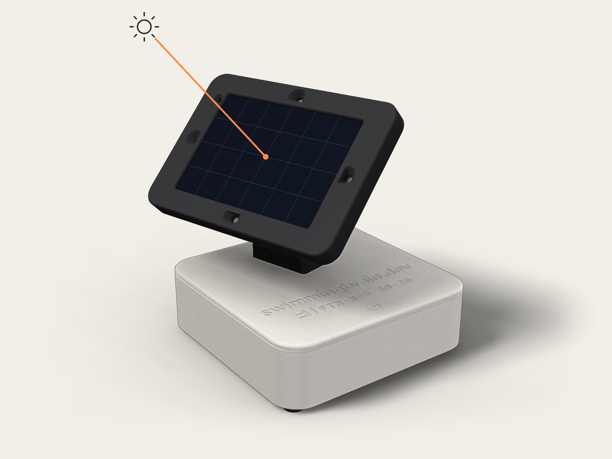

<h1 align="center">brainsolpi</h1>

<p align="center">
  The Raspberry Pi side of brainSOL.<br/>
  A dual axis solar tracker that follows the light.
</p>

<p align="center">
  
</p>

<p align="center">
  <a href="https://sol.swimmingbrain.dev"><strong>See it live &rarr; sol.swimmingbrain.dev</strong></a>
</p>

brainSOL turns parts of the Keyestudio KS0530 solar tracking kit, a Raspberry Pi 3B+ and a 3D printed body
into a tracker that turns its panel toward a lamp or the sun. This repo holds everything on the Pi side: one
Python service that runs the control loop at 50 Hz, talks to the UNO over USB and serves the live page, plus
the firmware for the UNO, the CAD of the body and the scripts that set up the Pi.

## Try it in one minute

On any PC with [uv](https://docs.astral.sh/uv/) and Python 3.11 or newer:

```
git clone https://github.com/swimmingbrain/brainsolpi.git
cd brainsolpi
uv run brainsolpi demo
```

It simulates the whole tracker on your computer, prints the address to open and an admin pin for this run,
and keeps nothing after Ctrl+C. Unlock the admin tools with the pin, drag the lamp in the 3D view and watch
the panel follow, then try a sky scan or the cosine experiment.

## Build your own

1. Get the parts, most of them come from the kit: [docs/parts.md](docs/parts.md)
2. Set up the Pi, it runs the simulation until the board shows up: [docs/setup.md](docs/setup.md)
3. Measure the kit parts and print the fit test: [hardware/MEASURE.md](hardware/MEASURE.md)
4. Print the body: [hardware/PRINTING.md](hardware/PRINTING.md)
5. Wire it, everything plugs together: [docs/wiring.md](docs/wiring.md)
6. Flash the UNO, run the doctor and centre the servos: [docs/first-start.md](docs/first-start.md)
7. Put it together with the screws of the kit: [hardware/ASSEMBLY.md](hardware/ASSEMBLY.md)
8. Calibrate in the admin tools and track the first light: [docs/first-start.md](docs/first-start.md)
9. Show it on the public page through a tunnel: [deploy/tunnel.md](deploy/tunnel.md) and
   [docs/talk.md](docs/talk.md)

When something is off: [docs/troubleshooting.md](docs/troubleshooting.md).

## Commands

| command | what it does |
|---|---|
| `brainsolpi run` | the tracker and the web server on port 8080. `--driver auto` (the default) uses the board when one answers within 6 s, otherwise it runs the sim and keeps looking for a board every 3 s. `--driver sim`, `bridge` or `fake` pick one |
| `brainsolpi demo` | the sim on this computer with a pin for the run, nothing is kept |
| `brainsolpi doctor` | a step by step check of the board, the sensors and the servos, then the exact next steps. `--fake` tries it on a simulated board |
| `brainsolpi flash` | writes `firmware/brainsol_bridge.hex` to the UNO with avrdude and waits for it to say hello |
| `brainsolpi setpin` | asks for the admin pin twice and stores a salted hash, a running tracker takes it over. `--check` only tells by its exit code whether a pin is set |
| `brainsolpi centre` | holds both servos at 1500 us while the horns go on |

`doctor`, `flash` and `centre` need the board alone, so they stop the `brainsolpi` service while they run
and start it again at the end.

## How it works

- The UNO runs a small bridge firmware. It sums the readings of the four photoresistors, reads the BH1750,
  sends 50 frames per second and moves the servos only when the Pi says so.
- The Pi normalises the four readings, compares opposite sensors and turns the error into a speed for each
  axis, with a dead band against hunting and limits on speed and acceleration for smooth motion.
- Pan covers -90 to 90 degrees, so for light from behind the panel tilts over the top.
- Besides tracking the light the head can follow the computed sun, scan the sky and run experiments like the
  cosine law.
- The web app in the [brainsol](https://github.com/swimmingbrain/brainsol) repo shows a live 3D twin and the
  numbers. It talks to the Pi over a WebSocket, both protocols are in [docs/protocol.md](docs/protocol.md).

## Repo map

```
brainsolpi/   the Python package: control loop, drivers, simulation, web server, the commands
tests/        pytest, from the controller math to a full WebSocket session against a fake board
firmware/     the bridge sketch for the UNO, the prebuilt hex, flash.sh and a host test
deploy/       install, update, web app and uninstall scripts, the systemd unit, the tunnel notes
hardware/     the build123d CAD, exports as STL, STEP, 3MF and GLB, renders, measure, print and assembly notes
docs/         parts, setup, wiring, first start, talk, troubleshooting and the protocols
```

## Development

```
uv sync
uv run pytest
uv run brainsolpi run --driver sim --pin 2468 --config-dir tmp/config --data-dir tmp/data
```

The tests run the controller in the simulation from hundreds of poses, drive the bridge driver against a fake
board that speaks the serial protocol, talk to the server over a real WebSocket and run ten simulated
minutes of random commands. `--driver fake` runs the real serial code path against that fake board.

## Tech stack

| part | what |
|---|---|
| Service | Python 3.11+, asyncio, aiohttp, pyserial, astral |
| Firmware | Arduino sketch for the ATmega328P with Servo and Wire |
| CAD | build123d, manifold3d, trimesh, pyvista for the renders |
| Pi | Raspberry Pi OS Lite 64 bit, systemd, avrdude |
| Web app | SvelteKit in the brainsol repo |

## License

MIT, see [LICENSE](LICENSE).

The FHV logo in `hardware/cad/assets/fhv_logo.svg`, engraved into the lid, belongs to FHV (Fachhochschule
Vorarlberg) and is not covered by the MIT license. The Inter and JetBrains Mono fonts next to it are under the
SIL Open Font License 1.1, their license texts lie beside them.
