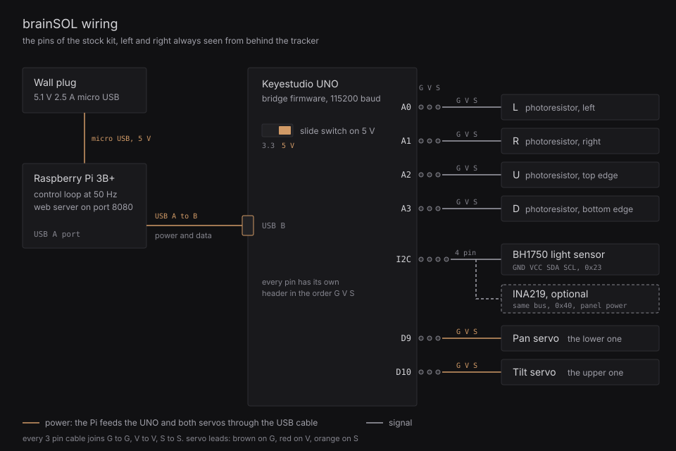

# Wiring

Everything plugs together, no soldering. The Pi is the brain, the UNO reads the sensors and drives the
servos, one USB cable joins them.

## Pin by pin

The pins are the ones of the stock kit wiring, the bridge firmware expects them this way.

| part | cable | UNO pin | note |
|---|---|---|---|
| photoresistor L | 3 pin, 200 mm | A0 | left of the panel seen from behind, one dot in the head |
| photoresistor R | 3 pin, 200 mm | A1 | right of the panel seen from behind, two dots |
| photoresistor U | 3 pin, 200 mm | A2 | top edge of the panel, three dots |
| photoresistor D | 3 pin, 200 mm | A3 | bottom edge of the panel, four dots |
| BH1750 light sensor | 4 pin, 350 mm | I2C header GND VCC SDA SCL | at the far end of the board, SDA is A4 and SCL is A5 |
| pan servo, the lower one | its own lead | D9 | brown on G |
| tilt servo, the upper one | its own lead | D10 | brown on G |
| UNO | USB A to B cable of the kit | lower USB port of the Pi, next to the Ethernet jack | power and data |
| Pi | micro USB (Pi 3B+) or USB C (Pi 4) | wall plug | the official 5.1 V 2.5 A or 5.1 V 3 A supply or a better one |
| INA219, optional | 4 single wires | V, G, A4 and A5 | see below |

L, R, U and D are named in the frame of the panel, seen from behind the tracker. Standing in front of the
panel, L is on your right. The dots in the back shell of the head show which module sits where.

## G V S

The Keyestudio UNO has a 3 pin header for every pin, so no sensor shield is needed. Each header has the
order G V S: G is ground, V is the supply, S is the signal. The photoresistor modules have the same three
pins on their edge.

- A 3 pin cable has to join G to G, V to V and S to S. Note the colour of the wire on the G pin of the module
  and put the same colour on the G row of the UNO.
- A servo lead has its own colours: brown on G, red on V, orange on S.
- A cable that is turned round on one end swaps G and S. The sensor then reads 0 or the full scale and never
  changes. `brainsolpi doctor` finds that. Unplug it, turn it and plug it in again.

## The 5 V switch

A small slide switch on the UNO sets the V pins to 3.3 V or 5 V. It must stand on 5 V. On 3.3 V the servos
barely move and the readings of the light sensors shrink.

## Power

The Pi powers the UNO and both servos through the USB cable. There is no second supply, so the supply of the
Pi carries everything: use the official supply of your Pi or a better one, with the cable it came with. That
is 5.1 V 2.5 A over micro USB for a Pi 3B+ and 5.1 V 3 A over USB C for a Pi 4. The diagram above shows the
Pi 3B+. The motion limits keep the current low, see the power entry in
`docs/troubleshooting.md` for what a weak supply looks like and what the low voltage warning of the Pi means.

## The optional INA219

The kit has nothing that measures the current of the solar panel, so the tracker estimates the panel power
from the light on the BH1750. An INA219 module measures voltage and current for real. The firmware finds it
on address 0x40 by itself, the page then shows the power as measured.

- VCC to a V pin, GND to a G pin, SDA to the S pin of A4, SCL to the S pin of A5. It shares the bus with the
  BH1750.
- Panel plus to VIN+, VIN- to one end of a load resistor, the other end of the resistor and panel minus to
  GND. Without a load no current flows and the power reads 0.

`docs/parts.md` says more about the module and the load.
